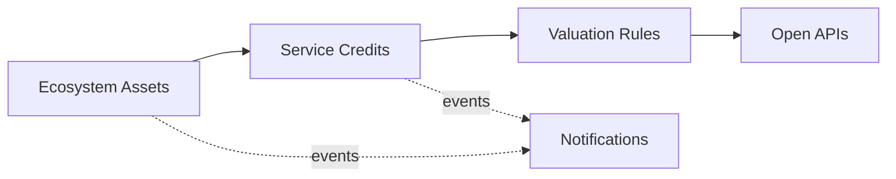

# Domain Model and Bounded Contexts

Ubiquitous language and context design (view VP-4). Domain-standard concepts are mapped
normatively in `../domain/domain-standards.md` (CR-5).

## Ubiquitous language (selected terms)

| Term | Meaning |
|---|---|
| **Ecosystem asset** | A wetland, forest, mangrove, grassland or river under stewardship |
| **Service capacity** | An asset's verified capacity to supply an ecosystem service, in credit units |
| **Credit issuance** | One issuance of service credits against verified capacity |
| **Valuation rule** | A decision rule binding a service type to value and uncertainty envelopes |
| **Monitoring station** | A flux tower, gauge, camera trap or soil probe feeding condition data |
| **Ecosystem health score** | A transparent 0-100 risk score from degradation signals |

## Bounded contexts and invariants

### Ecosystem Assets — `ecosystem-asset-service`
Registry of ecosystem assets under stewardship (SEEA EA extent accounts). Lifecycle: `ACTIVE` → transitions
protect, restore. Land and asset data can be location-sensitive: precise coordinates are never required by any contract; assets are identified by internal UUIDs and region codes only.

### Service Credits — `service-credit-service`
Verified service-capacity accounts per asset and the credit issuances against them. **Invariant (ADR-0004): credits issued against an ecosystem asset never exceed its verified service capacity — an issuance that would overrun it is rejected (422) and records nothing.** Consumption records are
append-only evidence; a rejected operation records nothing.

### Valuation Rules — `valuation-rules-service`
Decision rules binding service types to value and uncertainty envelopes. Only ACTIVE rules decide; evaluation order is by priority; every decision
is ALLOWED / DEGRADED / DENIED with the matched rule and a human-readable reason.

### Monitoring Stations — `monitoring-station-service`
Registry of monitoring stations feeding ecosystem condition data.

### Notifications — `notification-service`
Delivery trail for audit; recipients are never logged.

## Context map

